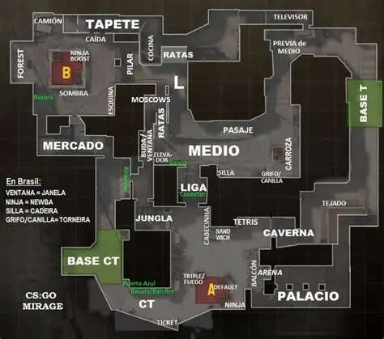

# 🎮 Counter-Strike 2: Taktický manuál operátora

Vítejte v oficiálním průvodci pro hráče **Counter-Strike 2**. Tento repozitář slouží jako kompletní databáze výzbroje, map, konfiguračních skriptů a herních mechanik pro kompetitivní zápasy.

---

## 1. Základní profil a pravidla hry

Úspěch v zápase nestojí jen na rychlých reflexech, ale především na týmové komunikaci a ekonomice. Běžní hráči spoléhají na štěstí, *profesionálové se řídí přesnými daty a načasováním*. Někdy je *komunikace v týmu **opravdu náročná***, ale bez ní se vyhrát nedá. ~~Staré zvyky z CS:GO už na sub-tick serverech neplatí.~~

### Podrobné sekce manuálu
Pro detailní rozbor jednotlivých částí hry navštivte připravené dokumenty v tomto repozitáři:
- [Přehled zbraní a ekonomiky](zbrane.md)
- [Aktivní mapy a callouty](mapy.md)

### Příprava před každým kolem
1. Zkontrolovat stav peněz celého týmu (Eco / Force / Full buy).
2. Nakoupit primární zbraň, vestu s helmou a utility.
3. Domluvit základní rozestavení na mapě.

### Checklist operátora
- [x] Nastavit vlastní zaměřovač (Crosshair) a citlivost myši
- [x] Vyladit `autoexec.cfg` pro stabilní FPS
- [ ] Dosáhnout hodnosti Global Elite / 25 000+ Premier rating

---

## 2. Uživatelské zdroje a schéma taktiky

Další informace a aktualizace najdete na [oficiálním webu Counter-Strike](https://www.counter-strike.net) nebo v [komunitní wiki na Liquipedii](https://liquipedia.net/counterstrike).

Níže je zobrazeno taktické schéma obsazení bodu A na mapě Mirage:



---

## 3. Konfigurační skript (Autoexec)

Pro maximální odezvu a čistý obraz používáme v konfiguračním souboru následující příkazy:

```cfg
// Optimalizace sítě a obrazu pro CS2
fps_max 400
cl_showfps 1
cl_radar_always_centered 0
cl_radar_scale 0.45

// Bind na jumpthrow pro přesné kouřové granáty
alias "+jumpaction" "+jump;"
alias "+throwaction" "-attack; -attack2"
alias "-jumpaction" "-jump"
bind "v" "+jumpaction;+throwaction;"
