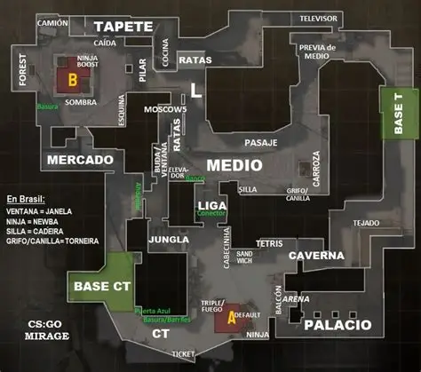
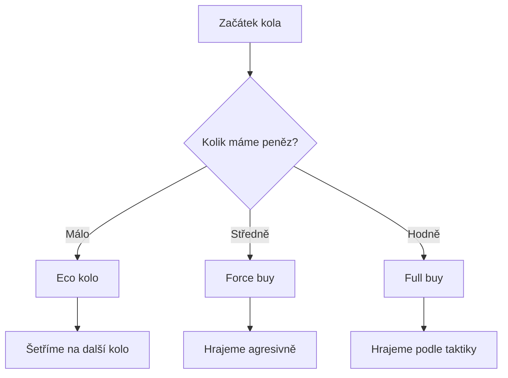

<div align="center">

# 🎮 Counter-Strike 2
### Taktický manuál operátora


*Přehled výzbroje, map, konfigurace a herních mechanik pro kompetitivní zápasy.*

</div>

---

## 1. Základní profil a pravidla hry

Úspěch v zápase nestojí jen na rychlých reflexech, ale především na **týmové komunikaci** a **ekonomice**. Běžní hráči spoléhají na štěstí, *profesionálové se řídí přesnými daty a načasováním*. Někdy je *komunikace v týmu **opravdu náročná***, ale bez ní se vyhrát nedá. ~~Staré zvyky z CS:GO už na sub-tick serverech neplatí.~~

> 💡 **Tip:** Nejdůležitější je mít ve hře plán. Bez něj z kola nic nebude.

### Podrobné sekce manuálu

- 🔫 [Přehled zbraní a ekonomiky](zbrane.md)
- 🗺️ [Aktivní mapy a callouty](mapy.md)

### Příprava před každým kolem

1. Zkontrolovat stav peněz celého týmu (Eco / Force / Full buy).
2. Nakoupit primární zbraň, vestu s helmou a utility.
3. Domluvit základní rozestavení na mapě.

### Checklist operátora

- [x] Nastavit vlastní zaměřovač (Crosshair) a citlivost myši
- [x] Vyladit `autoexec.cfg` pro stabilní FPS
- [ ] Dosáhnout hodnosti Global Elite / 25 000+ Premier rating

---

## 2. Zdroje a taktické schéma

Další informace najdete na [oficiálním webu Counter-Strike](https://www.counter-strike.net) nebo v [komunitní wiki na Liquipedii](https://liquipedia.net/counterstrike).

Taktické schéma obsazení bodu A na mapě Mirage:

<div align="center">



*Obrázek 1: Obsazení bodu A na mapě Mirage*

</div>

---

## 3. Konfigurační skript (Autoexec)

Pro maximální odezvu a čistý obraz používáme v konfiguračním souboru následující příkazy:

```cfg
// Optimalizace sítě a obrazu pro CS2
fps_max 400
cl_showfps 1
cl_radar_always_centered 0
cl_radar_scale 0.45

// Bind na jumpthrow pro přesné kouřové granáty
alias "+jumpaction" "+jump;"
alias "+throwaction" "-attack; -attack2"
alias "-jumpaction" "-jump"
bind "v" "+jumpaction;+throwaction;"
```

---

## 4. Porovnání základních zbraní

| Zbraň  | Strana | Cena    | Výhoda                        | Nevýhoda                      |
|--------|:------:|--------:|-------------------------------|-------------------------------|
| AK-47  | T      | 2 700 $ | Zabije na jednu ránu do hlavy | Těžko zvládnutelný zpětný ráz |
| M4A4   | CT     | 2 900 $ | Větší zásobník (30 nábojů)    | Slabší než AK-47              |
| M4A1-S | CT     | 2 900 $ | Tlumič, přesnost              | Menší zásobník (20 nábojů)    |
| AWP    | T / CT | 4 750 $ | Zabije jednou ranou           | Drahá, pomalá střelba         |

---

## 5. Statistiky a rozhodování

### Vědecký zápis: procento headshotů

```math
HS\% = \frac{\text{počet headshotů}}{\text{počet zabití}} \times 100
```

### Rozhodovací diagram nákupu



---

<div align="center">

*Vytvořeno jako školní projekt, Markdown na GitHubu* 🚀

</div>
